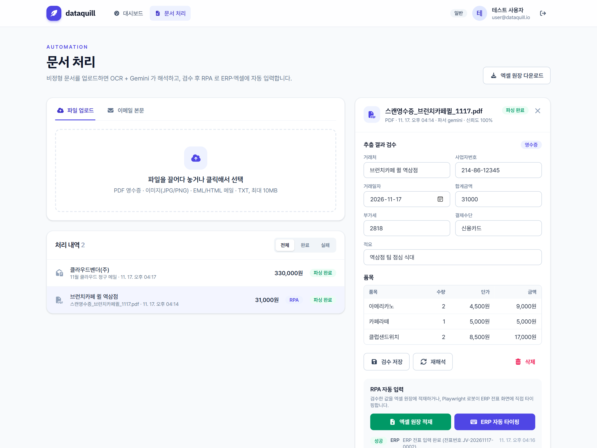
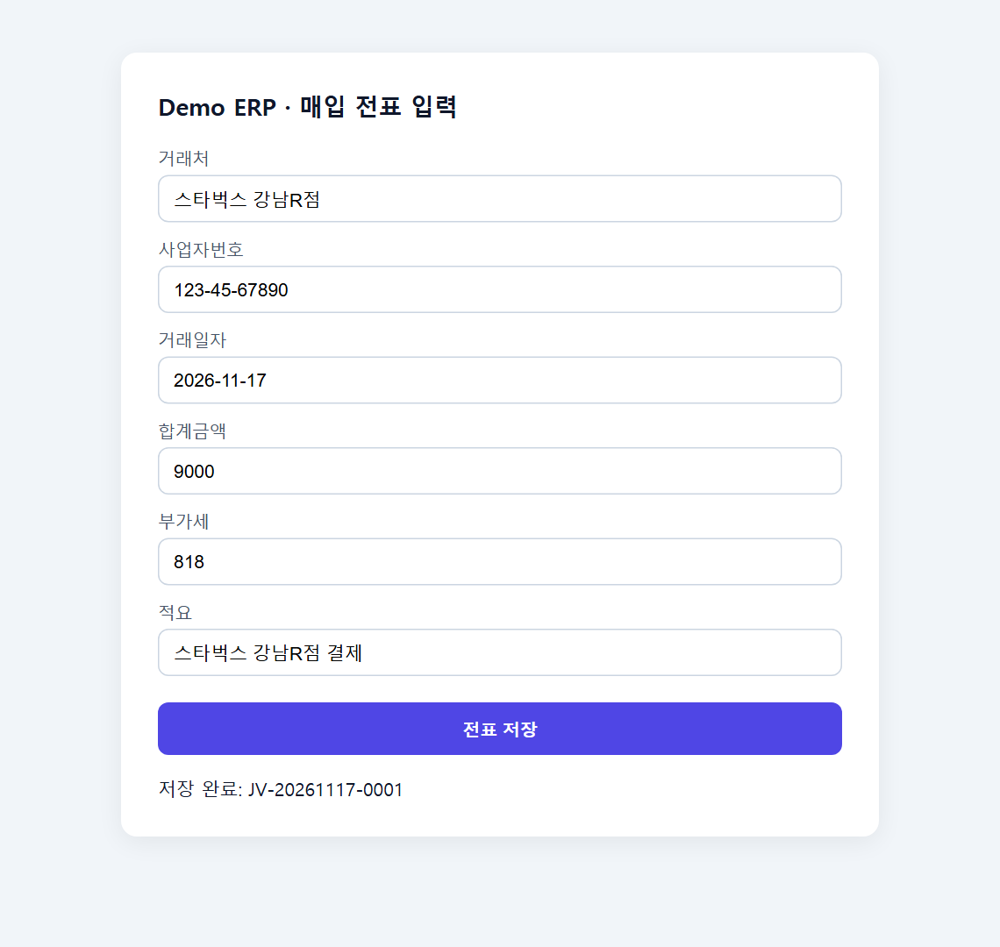
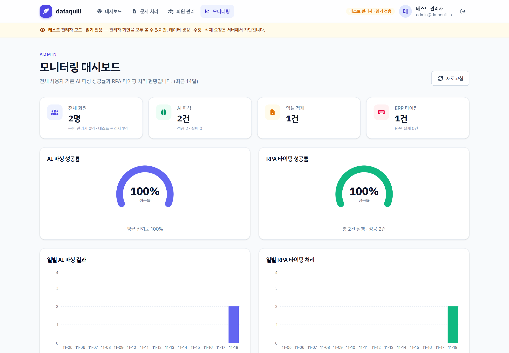
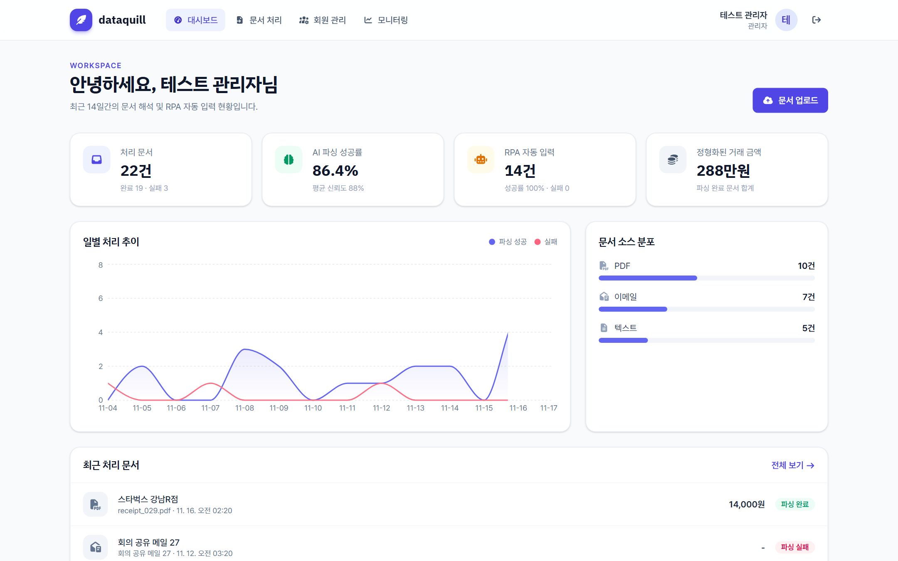
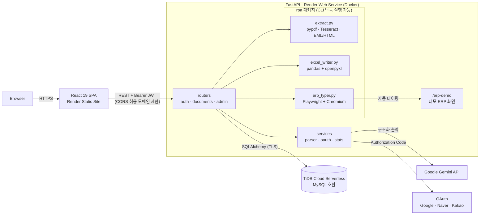
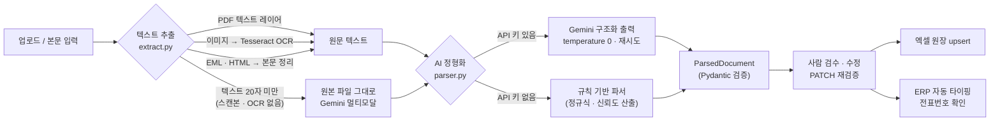

<div align="center">

# DataQuill

### 생성형 AI × RPA 기반 데이터 입력 자동화 플랫폼

**영수증·세금계산서·거래 이메일 같은 비정형 문서를 AI가 읽어 정형화하고,<br/>RPA 로봇이 ERP 화면과 엑셀 원장에 대신 입력합니다.**

<br/>


<br/>


[](https://github.com/fsclass-n/dataquill/actions/workflows/deploy.yml)

[](https://github.com/fsclass-n/dataquill)
[](https://github.com/fsclass-n/dataquill/issues)
[](https://github.com/fsclass-n/dataquill/commits/main)
[](https://github.com/fsclass-n/dataquill)

<br/>

[](https://dataquill.onrender.com)

<sub>로그인 화면의 테스트 계정 버튼으로 바로 체험할 수 있습니다. (무료 플랜 특성상 첫 요청은 서버 기동으로 30초 정도 걸릴 수 있습니다)</sub>

</div>

---

## 목차

1. [프로젝트 개요](#1-프로젝트-개요)
2. [주요 기능](#2-주요-기능)
3. [Architecture & Data Pipeline](#3-architecture--data-pipeline)
4. [Key Technical Challenges & Solutions](#4-key-technical-challenges--solutions)
5. [Tech Stack](#5-tech-stack)
6. [API Architecture](#6-api-architecture)
7. [Directory Structure](#7-directory-structure)
8. [계정과 권한 모델](#8-계정과-권한-모델)
9. [로컬 실행 · 검증](#9-로컬-실행--검증)
10. [배포 · CI/CD](#10-배포--cicd)
11. [한계와 향후 계획](#11-한계와-향후-계획)

---

## 1. 프로젝트 개요

| 구분 | 내용 |
| --- | --- |
| **문제** | 경리·총무 담당자는 영수증과 청구 메일을 보고 **ERP에 한 번, 엑셀 원장에 또 한 번** 손으로 입력합니다. 문서 형식이 제각각이라 규칙(정규식)만으로는 자동화가 어렵고, 사내 ERP는 연동 API가 없는 경우가 많습니다. |
| **해결** | 형식 문제는 **생성형 AI(Gemini 구조화 출력)** 로, API가 없는 문제는 **사람처럼 화면에 입력하는 RPA(Playwright)** 로 풉니다. AI가 틀릴 수 있으므로 둘 사이에 **사람 검수 단계**를 일부러 넣었습니다. |
| **흐름** | 업로드 → 텍스트 추출(PDF·OCR·이메일) → AI 정형화 → 사용자 검수·수정 → 엑셀 원장 적재 / ERP 자동 타이핑 |
| **성격** | K-Digital 심화 과정 「생성형 AI와 AWS 클라우드를 활용한 풀스택 & 자동화 실무 개발」 Final Project (3조) |

---

## 2. 주요 기능

| 기능 | 설명 |
| --- | --- |
| **다양한 입력 형식** | PDF, 이미지(JPG·PNG·WEBP·TIFF 등), EML, HTML, TXT 업로드(최대 10MB) 및 이메일 본문 붙여넣기 |
| **AI 구조화 추출** | 거래처·사업자번호·거래일자·합계·부가세·결제수단·품목·적요를 JSON으로 추출하고, 신뢰도(confidence)를 함께 표시 |
| **사람 검수** | 추출 결과를 화면에서 수정·저장(서버에서 같은 스키마로 재검증), 재해석 지원 |
| **엑셀 원장 적재** | 문서 ID 기준으로 교체(upsert)해 여러 번 적재해도 중복 행이 생기지 않음, 원장 파일 다운로드 |
| **ERP 자동 타이핑** | Playwright가 웹 ERP 전표 화면에 값을 입력·저장하고, ERP가 발급한 **전표번호를 확인한 뒤에만 성공**으로 기록 |
| **대시보드 · 모니터링** | 사용자 KPI·일별 처리 추이, 관리자용 AI 파싱 성공률·RPA 성공률·최근 실패 목록 |
| **인증 · 권한** | 이메일 가입(JWT), Google·Naver·Kakao OAuth, 운영 관리자 / 읽기 전용 테스트 관리자 / 일반 사용자 |

<table>
  <tr>
    <td align="center"><br/><sub>문서 업로드 · AI 추출 결과 검수 · RPA 실행</sub></td>
    <td align="center"><br/><sub>로봇이 입력한 데모 ERP 전표 (전표번호 발급)</sub></td>
  </tr>
  <tr>
    <td align="center"><br/><sub>관리자 모니터링 (파싱·RPA 성공률)</sub></td>
    <td align="center"><br/><sub>사용자 대시보드</sub></td>
  </tr>
</table>

---

## 3. Architecture & Data Pipeline

### 3.1 System Architecture



- **프론트·백엔드 분리 배포**: 화면만 바뀌었을 때 Chromium이 포함된 무거운 백엔드 이미지를 다시 빌드하지 않습니다.
- **`rpa` 패키지 분리**: 웹 계층(`backend.app`)과 자동화 계층(`rpa`)을 나눠, 나중에 별도 워커로 옮기기 쉽게 했습니다.
- **무상태 컨테이너 + 관리형 DB**: 재배포해도 데이터는 TiDB에 남습니다. 로컬·테스트는 같은 코드로 SQLite를 씁니다.

### 3.2 Document Processing Pipeline



| 단계 | 모듈 | 처리 | 실패 시 |
| --- | --- | --- | --- |
| ① 추출 | `rpa/extract.py` | 가장 싸고 정확한 방법부터: 텍스트 레이어 → OCR → LLM 멀티모달 | 지원하지 않는 형식은 415, 추출 실패는 다음 단계로 대체 |
| ② 정형화 | `services/parser.py` | Gemini에 Pydantic 모델을 응답 스키마로 전달, 없는 값은 null | 429·5xx는 2s → 5s → 10s 재시도, 키 없으면 규칙 파서 |
| ③ 검수 | `routers/documents.py` | 화면에서 수정한 값을 같은 스키마로 다시 검증 | 형식 오류는 422 |
| ④ 입력 | `rpa/excel_writer.py`, `rpa/erp_typer.py` | 엑셀 upsert, ERP 화면 입력 후 결과 요소 확인 | 실패 사유를 작업 이력(`rpa_jobs`)에 기록 |

---

## 4. Key Technical Challenges & Solutions

### Challenge 1. 형식이 제각각인 문서에서 신뢰할 수 있는 값 뽑기

> **Problem** — 같은 영수증이라도 텍스트 PDF, 스캔 PDF, 사진, 이메일 본문 등 형태가 다릅니다. 프롬프트로 "JSON으로 답해 줘"라고만 하면 필드가 빠지거나 형식이 깨지고, 회계 데이터에서 가장 위험한 **AI가 지어낸 값(환각)** 도 막기 어렵습니다.

**Solution**

| 전략 | 구현 |
| --- | --- |
| **단계적 추출** | 텍스트 레이어 → Tesseract(kor+eng) → Gemini 멀티모달 순으로 대체 (`MIN_TEXT_LENGTH = 20`) |
| **스키마 하나로 통일** | `ParsedDocument`(Pydantic)를 **Gemini 응답 스키마이자 API 검증 모델**로 함께 사용 → 한쪽만 고치면 됨 |
| **환각 통제 3단계** | 프롬프트("문서에 없는 값은 추측하지 말고 null") + `temperature=0` + **사람 검수** |
| **대체 경로** | API 키가 없거나 장애가 나도 서비스가 멈추지 않도록 규칙 기반 파서 제공 (찾은 핵심 필드 수로 신뢰도 산출) |

```python
config = types.GenerateContentConfig(
    response_mime_type="application/json",
    response_schema=ParsedDocument,   # API 검증에 쓰는 같은 Pydantic 모델
    temperature=0,
)
for attempt, delay in enumerate((*RETRY_DELAYS, None)):          # 2s → 5s → 10s
    try:
        response = client.models.generate_content(model=settings.gemini_model, contents=contents, config=config)
        break
    except genai_errors.APIError as exc:
        if exc.code in RETRYABLE_STATUS and delay is not None:   # 429·500·503·504 만 재시도
            time.sleep(delay)
            continue
        raise ParseError(...)                                    # 400 같은 요청 오류는 즉시 실패
return ParsedDocument.model_validate_json(response.text).model_dump()
```

> **Result** — 운영 환경 샘플 영수증에서 거래처·사업자번호·금액·부가세·품목이 정상 추출되었습니다(신뢰도 0.98). 정량 정확도는 정답셋이 없어 측정하지 않았으며, 향후 과제로 두었습니다.

---

### Challenge 2. "눌렀는데 저장 안 됨"을 막는 RPA 설계

> **Problem** — RPA는 버튼 클릭까지는 성공해도 실제로는 저장되지 않는 경우가 흔합니다. 또 사용자가 적재 버튼을 여러 번 누르면 엑셀에 같은 행이 쌓입니다.

**Solution**

- **결과 검증**: 클릭으로 끝내지 않고, ERP 결과 요소의 `data-status="ok"`와 **발급된 전표번호**를 확인해야 성공으로 기록합니다.
- **화면 구조와 코드 분리**: `FIELD_SELECTORS` 맵만 바꾸면 다른 ERP 화면에 붙일 수 있고, `python -m rpa.erp_typer`로 단독 실행도 됩니다.
- **멱등 적재**: 엑셀 원장은 **문서 ID 기준으로 기존 행을 교체**하므로 몇 번을 적재해도 결과가 같습니다.
- **읽을 수 있는 실패 메시지**: Chromium 미설치 같은 환경 오류를 안내 문구로 바꿔 작업 이력에 남깁니다.

```python
page.click(SUBMIT_SELECTOR)
result = page.wait_for_selector("#result[data-status]", timeout=10_000)
if result.get_attribute("data-status") != "ok":
    raise ErpTypingError(result.inner_text() or "ERP 가 입력을 거부했습니다.")
return result.get_attribute("data-voucher")          # 전표번호를 받아야 성공
```

> **Result** — 운영 환경에서 Playwright가 데모 ERP에 입력하고 전표번호(`JV-YYYYMMDD-NNNN`)를 받아 오는 전 과정을 확인했습니다.

---

### Challenge 3. 공개 테스트 계정이 실제 관리자 권한을 갖던 보안 문제

> **Problem** — 포트폴리오 체험용으로 로그인 화면에 비밀번호를 공개한 관리자 계정이 **실제 관리자 권한**을 갖고 있어, 누구나 회원 권한을 바꿀 수 있었습니다.

**Solution**

| 역할 | 진입 | 권한 |
| --- | --- | --- |
| `admin` 운영 관리자 | `/admin/login`에서 서버 환경 변수 `ADMIN_TOKEN` 입력 | 전체 CRUD, 회원 권한 변경 |
| `test_admin` 테스트 관리자 | 로그인 화면 버튼 | 관리자 화면 **조회만**, 쓰기 요청은 403 |
| `user` 일반 사용자 | 가입 · OAuth · 테스트 버튼 | 본인 문서만 |

- **단일 진입점에서 강제**: `deps.get_current_user`에서 `test_admin`의 GET/HEAD/OPTIONS 외 요청을 403으로 막아, **새 API를 추가해도 자동 적용**됩니다.
- **토큰 검증**: `secrets.compare_digest`로 비교하고, 같은 IP에서 5회 실패하면 10분간 차단(429), 토큰이 설정되지 않으면 503.
- **공개 계정 보호**: 테스트 계정 권한은 서버가 뜰 때마다 고정값으로 되돌리고, 권한 변경 API로도 바꿀 수 없습니다.

> **Result** — 권한 관련 테스트 8개(토큰 로그인·차단·미설정, 조회 허용, 쓰기 차단, 권한 고정·복원)를 추가했고 전체 **pytest 30개가 통과**합니다.

---

### Challenge 4. 로컬에서는 되고 운영에서만 실패하는 문제들

| 증상 | 원인 분석 | 해결 · 재발 방지 |
| --- | --- | --- |
| 코드 변경 없이 Docker 빌드 실패 (`ttf-ubuntu-font-family` 설치 불가) | `python:3.11-slim` 태그가 Debian 13으로 바뀜. Playwright 1.52 소스(`nativeDeps.ts`)를 확인하니 의존성 목록이 Debian 11/12까지만 있음 | `python:3.11-slim-bookworm`으로 **기본 이미지 OS 고정** |
| 키를 넣지 않았는데 AI·OAuth가 "설정됨" | `.env`의 `KEY=   # 주석`에서 **빈 값 뒤 주석이 값으로 읽힘** | 주석을 별도 줄로 이동, 규칙 문서화. 헬스 체크에 파서 종류를 노출해 둔 덕분에 발견 |
| TiDB 연결 실패 `1105 insecure transport` | TiDB Serverless는 TLS 필수 | `DB_SSL=true` + certifi CA. 운영 DB는 건드리지 않고 **임시 DB로 검증 후 삭제** |
| 운영 첫 점검에서 Gemini 503 | 사용량 폭주 시 일시 오류 | 429·5xx만 백오프 재시도, 재시도 횟수를 검증하는 테스트 추가 |
| 운영에서만 ERP 타이핑 연결 거부 | Render 컨테이너는 `PORT=10000`인데 `localhost:8000`으로 접속 | 기본 대상 주소를 `127.0.0.1:$PORT`로 변경 |
| `/login` 새로고침 시 404 | 정적 호스팅에 SPA 라우팅 규칙 없음 | `/*` → `/index.html` Rewrite |

---

## 5. Tech Stack

| 구분 | 기술 | 선택 이유 |
| --- | --- | --- |
| **Backend** |      | Pydantic으로 요청 검증·응답 모델·LLM 출력 스키마를 한 번에 정의, `/docs` 자동 생성 |
| **AI** |   | 구조화 출력(response_schema)과 멀티모달(스캔본·이미지) 지원 |
| **RPA / Data** |      | API 없는 ERP 화면 자동 입력, 엑셀 원장 관리, PDF·HTML 텍스트 추출 |
| **Frontend** |      | 페이지 단위 코드 스플리팅(단일 885KB → 메인 416KB), 디자인 토큰(`@utility`) |
| **Database** |   | 운영은 관리형 MySQL 호환 DB(TLS), 로컬·테스트는 URL만 바꿔 SQLite |
| **Infra / DevOps** |     | 변경 영역만 검증·배포(paths-filter · Build Filter) |

---

## 6. API Architecture

FastAPI 라우터(웹 계층) → 서비스(AI 파싱·OAuth·통계) → `rpa` 패키지(자동화 계층)로 역할을 나눴습니다. 인증·권한은 의존성(`deps.py`) 한 곳에서 처리합니다.

| Method | Endpoint | 설명 | 권한 |
| --- | --- | --- | --- |
| `POST` | `/api/auth/register` · `/api/auth/login` | 이메일 가입 · 로그인 (JWT 발급) | - |
| `POST` | `/api/auth/admin-login` | `ADMIN_TOKEN` 운영 관리자 로그인 (5회 실패 시 10분 차단) | - |
| `GET` | `/api/auth/oauth/{provider}/login` · `/callback` | Google · Naver · Kakao OAuth (state 쿠키 CSRF 검증) | - |
| `GET` | `/api/auth/me` · `/api/auth/providers` | 내 정보 · 활성화된 OAuth 제공자 | 로그인 |
| `GET` | `/api/dashboard` | 사용자 KPI · 일별 추이 | 로그인 |
| `GET` | `/api/documents` | 내 문서 목록 (상태 필터) | 로그인 |
| `POST` | `/api/documents/upload` | 파일 업로드 → 추출 → AI 정형화 | 로그인 |
| `POST` | `/api/documents/text` | 이메일 본문 입력 → AI 정형화 | 로그인 |
| `GET` · `PATCH` · `DELETE` | `/api/documents/{id}` | 상세 · 검수 수정(스키마 재검증) · 삭제 | 본인 |
| `POST` | `/api/documents/{id}/reparse` | 재해석 | 본인 |
| `POST` | `/api/documents/{id}/rpa` | 엑셀 적재 또는 ERP 자동 타이핑 (`target: excel \| erp`) | 본인 |
| `GET` | `/api/documents/ledger.xlsx` | 엑셀 원장 다운로드 | 로그인 |
| `GET` · `PATCH` | `/api/admin/users` · `/api/admin/users/{id}/role` | 회원 목록 · 권한 변경 | 관리자 |
| `GET` | `/api/admin/stats` | 파싱·RPA 성공률, 분포, 최근 실패 | 관리자 |
| `GET` | `/api/health` | 상태 · 현재 파서 종류(gemini / rules) | - |

> 전체 명세: https://dataquill-api.onrender.com/docs (Swagger UI)

**데이터 모델**: `users`(역할·OAuth 식별자) 1:N `documents`(원문·추출 결과 JSON·상태·파서) 1:N `rpa_jobs`(대상·결과·메시지)

---

## 7. Directory Structure

```text
dataquill/
├── backend/
│   ├── app/
│   │   ├── main.py              # 앱 생성, CORS, 테스트 계정 시드(권한 복원)
│   │   ├── config.py            # 루트 .env 단일 설정
│   │   ├── database.py          # SQLAlchemy 엔진 (SQLite / TiDB + TLS)
│   │   ├── deps.py              # 인증·권한 단일 진입점 (test_admin 쓰기 차단)
│   │   ├── security.py          # PBKDF2-SHA256(26만 회) 해시, JWT(HS256)
│   │   ├── models.py · schemas.py
│   │   ├── routers/             # auth · documents · admin · erp_demo
│   │   └── services/            # parser(Gemini/규칙) · oauth · stats
│   ├── tests/                   # pytest 30개 (외부 키 비움, 임시 DB)
│   └── Dockerfile               # python:3.11-slim-bookworm + Tesseract(kor) + Chromium
├── rpa/                         # 자동화 계층 (웹과 분리, CLI 단독 실행 가능)
│   ├── extract.py               # PDF · OCR · EML · HTML 텍스트 추출
│   ├── excel_writer.py          # 엑셀 원장 upsert
│   └── erp_typer.py             # Playwright ERP 자동 타이핑 + 결과 검증
├── frontend/
│   └── src/
│       ├── pages/               # Home · Login · Dashboard · Documents · admin/*
│       ├── components/layout/   # SiteLayout · Header · Footer
│       ├── api/                 # client.js (실 API) · mock.js (VITE_API_URL 미설정 시)
│       └── context/             # Auth · Toast
├── docs/
│   ├── md/                      # 작업일별 기록 (결정 · 검증 · 이슈)
│   ├── 산출물/ · 프로젝트_진행일지_*.hwpx
│   ├── pdf/                     # 진행일지 · 산출물 · 발표자료 PDF
│   ├── scripts/ · tools/        # 발표자료 · 문서 생성 스크립트
│   └── assets/                  # 화면 캡처 · QR
├── .github/workflows/deploy.yml # 변경 영역별 테스트·빌드·배포
├── render.yaml · netlify.toml · docker-compose.yml
└── requirements.txt · .env.example
```

---

## 8. 계정과 권한 모델

| 구분 | 진입 방법 | 권한 |
| --- | --- | --- |
| 운영 관리자 | `/admin/login` 에서 서버 환경 변수 `ADMIN_TOKEN` 입력 | 모든 데이터 생성 · 수정 · 삭제, 회원 권한 변경 |
| 테스트 관리자 | 로그인 화면 버튼 (`admin@dataquill.io` / `Admin1234!`) | 관리자 화면 조회만 가능, 모든 쓰기 요청은 서버에서 403 |
| 일반 사용자 | 이메일 가입 · OAuth · 테스트 버튼 (`user@dataquill.io` / `User1234!`) | 본인 문서 업로드 · 검수 · RPA |

- 테스트 계정은 `SEED_TEST_ACCOUNTS=true` 일 때 자동 생성되며, 비밀번호가 공개되어 있으므로 서버 기동 시마다 권한이 고정값으로 되돌아가고 권한 변경 API 로도 바꿀 수 없습니다.

---

## 9. 로컬 실행 · 검증

```bash
# 1) 환경 변수
cp .env.example .env            # SECRET_KEY 변경, 필요 시 GEMINI_API_KEY / OAuth 키 입력

# 2) 백엔드 (Python 3.11)
py -3.11 -m venv .venv
.venv/Scripts/pip install -r requirements.txt          # macOS/Linux: .venv/bin/pip
.venv/Scripts/python -m playwright install chromium    # ERP 자동 타이핑용
.venv/Scripts/python -m uvicorn backend.app.main:app --reload --port 8000

# 3) 프런트엔드
cd frontend && npm install && npm run dev               # http://localhost:5173
```

- API 문서: http://localhost:8000/docs · 데모 ERP(RPA 타이핑 대상): http://localhost:8000/erp-demo
- Docker: `docker compose up --build`
- **Mock 모드**: `VITE_API_URL` 을 비워 빌드하면 프런트엔드가 브라우저 내 목업 API(localStorage)로 동작합니다.

```bash
# 검증
.venv/Scripts/python -m pytest backend/tests -q        # 30 passed
cd frontend && npm run lint && npm run build
```

---

## 10. 배포 · CI/CD

| 구분 | URL | 플랫폼 |
| --- | --- | --- |
| Frontend | https://dataquill.onrender.com | Render Static Site (`/*` → `/index.html` Rewrite) |
| Backend API | https://dataquill-api.onrender.com | Render Web Service (Docker `backend/Dockerfile`) |
| Frontend (보조) | https://dataquill.netlify.app | Netlify |
| Database | TiDB Cloud Serverless | MySQL 호환 · TLS |

```text
git push main
 ├─ GitHub Actions (deploy.yml) ── paths-filter 로 바뀐 영역 판별
 │    ├─ frontend/**                          → npm ci · lint · build
 │    └─ backend/** · rpa/** · requirements   → pip install · pytest
 ├─ Render Static Site   → frontend/** 변경 시에만 빌드
 └─ Render Web Service   → backend/** · rpa/** · requirements.txt 변경 시에만 빌드 (Build Filter)
```

- 문서만 고친 커밋은 어떤 서비스도 다시 빌드하지 않습니다.
- 비밀 값은 `.env`(Git 제외)와 Render 대시보드에만 등록하고, `.env.example` 에 `[LOCAL]` / `[RENDER]` / `[RENDER-FE]` 로 등록 위치를 표시합니다.
- OAuth Redirect URI: `https://dataquill-api.onrender.com/api/auth/oauth/{google|naver|kakao}/callback`

---

## 11. 한계와 향후 계획

| 현재 한계 | 개선 계획 |
| --- | --- |
| RPA가 API 요청 안에서 동기로 실행 → 오래 걸리는 작업에 취약 | 작업 큐 + 워커 분리, 진행 상태 조회 (`rpa` 패키지가 이미 분리되어 있어 이전 비용이 낮음) |
| 업로드 원본이 컨테이너 디스크에 저장 → 재배포 시 원본 유실 가능 | S3 같은 오브젝트 스토리지로 이전 |
| 스키마 변경을 `create_all` 로 처리 | Alembic 마이그레이션 도입 |
| 파싱 품질을 샘플 단위로만 검증 | 문서 유형별 정답셋으로 필드 단위 정확도 측정, 프롬프트·모델 비교 |
| 데모 ERP 대상 검증 | 실제 ERP 커넥터(API 우선, 없으면 RPA), 조직(테넌트) 단위 권한 |

---

<div align="center">

**K-Digital 심화 Final Project · 3조** · 단계별 진행일지와 산출물은 [`docs/`](docs) · [`docs/pdf/`](docs/pdf) 에서 볼 수 있습니다.

</div>
